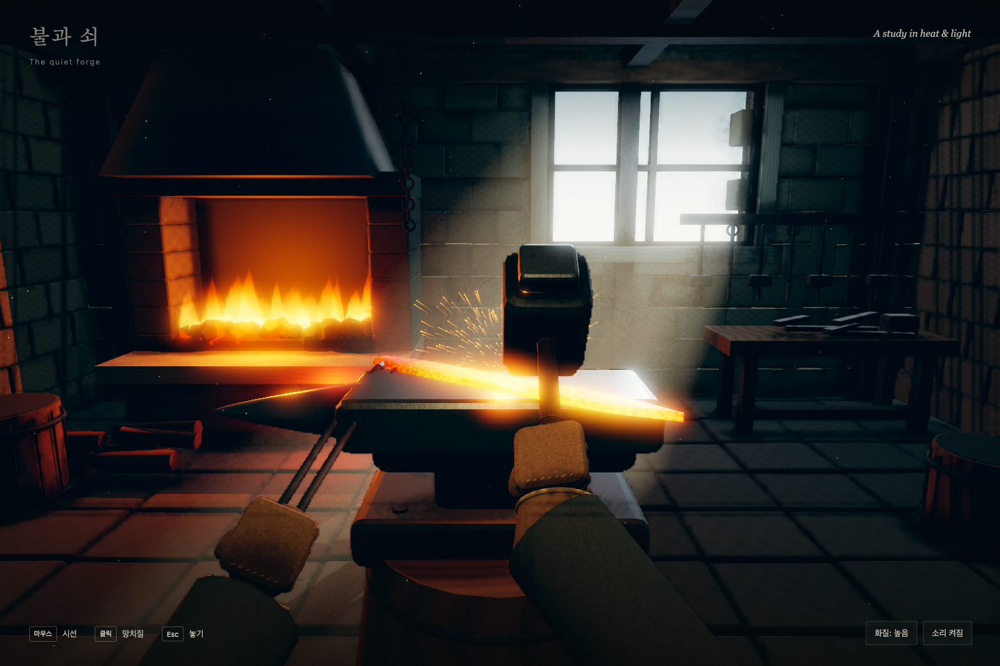

# 불과 쇠 — The quiet forge

> 이 저장소의 게임 코드는 OpenAI의 **GPT-6-Astra**가 Codex 데스크톱 앱에서 작성했습니다.
> 사람은 지시를 쓰고 결과를 검토했고, 공개용 정리(이 README·LICENSE·제3자 고지)는 **Claude Opus 5.5**가 했습니다.

three.js만으로 만든 1인칭 대장간 장면입니다. 모루 위에 놓인 달군 칼날을 망치로 두드립니다.
3D 모델·이미지·소리 파일 없이 형태·재질·효과음을 모두 코드로 만들고,
three.js까지 넣은 HTML 파일 하나로 오프라인에서 실행됩니다.



## English summary

The quiet forge is a first-person blacksmith scene: you strike a glowing blade on an anvil.
It is built with three.js and hand-written shaders only. There are no 3D models, images or
audio files; geometry, materials and sound effects are generated in code, and the whole game is
a single `index.html` (with three.js r160 inlined) that runs offline.

- **Who wrote the code:** GPT-6-Astra (OpenAI), in the Codex desktop app, reasoning effort xhigh,
  on 2026-11-11. Writing the code took about 13 minutes, measured from the first code write to the
  last code change. From the prompt to the completion report took about 19 minutes.
- **Prompt:** the full prompt is quoted below in Korean. It was the first message of the Codex
  session; there was no earlier conversation in that session.
- **Later work, not included here:** after the game was finished, GPT-6-Astra also recorded a
  roughly 24-second trailer video and adapted the game for the repository owner's website. Neither
  is in this repository, and neither is counted in the 13 minutes. The game code was not changed
  after it was finished.
- **Repository preparation:** Claude Opus 5.5 (Anthropic) chose the files to publish and wrote
  this README, the LICENSE, the third-party notice and the `.gitignore`. A person wrote the prompt
  and reviewed the results.
- **Run it:** open `index.html` in a browser with WebGL2. Click "대장간에 들어가기" (enter the forge),
  move the mouse to look, click or press Space to strike, and press Esc to let go.
- **License:** MIT for the game code. three.js r160 is inlined under its own MIT license; see
  `THIRD_PARTY_NOTICES.md`. This project is not made or endorsed by OpenAI or Anthropic.

## 제작 기록

| 항목 | 내용 |
| --- | --- |
| 모델 | GPT-6-Astra (OpenAI), Codex 데스크톱 앱 |
| 추론 수준 | xhigh |
| 실행일 | 2026-11-11 |
| 작업 시간 | 약 13분(첫 코드 작성부터 마지막 코드 수정까지) |
| 프롬프트 | 코드 작업을 시작한 지시 원문(아래) |

```text
three.js만으로 1인칭 대장간 장면을 단일 HTML로 만들어줘.
- 3D 모델·이미지·오디오 파일 없이 전부 코드로 생성 (효과음도 합성)
- 플레이는 모루 위 달군 칼날을 망치로 두드리는 것만. 마우스는 시선, 클릭은 망치질
- 재미보다 화질 우선: AO, 볼류메트릭 빛줄기, 블룸, 색보정을 직접 구현
- 장갑 낀 손, 화덕 불, 타격 불꽃, 창으로 드는 햇빛
- 조명과 후처리가 갖춰지면 중간 화면을 먼저 보여주고 계속 진행
```

이 지시는 Codex 작업 세션의 첫 메시지였고, 같은 세션에서 그 앞에 주고받은 대화는 없습니다.
작업 시간은 첫 코드 파일을 쓴 때부터 셉니다. 지시를 받고 완성을 보고하기까지는 약 19분이었습니다.

### 게임 완성 뒤 한 일 (작업 시간과 이 저장소에서 뺌)

- 같은 날 GPT-6-Astra(xhigh)가 이 게임을 녹화해 약 24초짜리 소개 영상을 만들었습니다.
  게임 코드는 바꾸지 않았고, 영상은 파일이 커서 넣지 않았습니다.
- 저장소 소유자의 웹사이트에 이 게임을 올리는 작업(사이트용으로 옮긴 코드, 화면 캡처, 계획 문서)도
  GPT-6-Astra가 했습니다. 이 저장소는 게임 자체만 담으므로 넣지 않았습니다.

## 역할

| 누가 | 한 일 |
| --- | --- |
| 저장소 소유자(사람) | 프롬프트 작성, 결과 검토 |
| GPT-6-Astra (OpenAI) | 게임 코드(`index.html`), 구현 계획 문서, 제작 중 화면과 검증 결과(`output/playwright/`) |
| Claude Opus 5.5 (Anthropic) | 공개용 정리: 올릴 파일 선별, 이 README, LICENSE, 제3자 고지, `.gitignore` |

커밋 이력도 같은 구분을 따릅니다. 첫 커밋은 GPT-6-Astra가 만든 파일을 고치지 않고 담았고
(커밋 메시지 본문에 모델 이름을 적었습니다), 두 번째 커밋이 공개용 정리입니다.

## 실행

`index.html`을 브라우저에서 바로 열면 됩니다. 설치나 빌드가 필요 없고 외부 요청도 없습니다.
WebGL2를 지원하는 브라우저가 필요합니다.

## 조작

- **대장간에 들어가기** 버튼으로 시작
- 마우스: 시선 / 클릭 또는 Space: 망치질 / Esc: 놓기(멈춤)
- 오른쪽 아래 버튼: 화질(표준·높음·최고), 소리 켜기·끄기

## 파일

- `index.html`: 게임 전체(약 711KB). 그중 약 670KB는 three.js r160(npm `three@0.160.1`)의
  `build/three.min.js`를 그대로 넣은 것이고, 나머지 약 41KB가 GPT-6-Astra가 쓴 장면·셰이더·입력·소리 코드입니다.
- `docs/superpowers/plans/2026-11-11-forge.md`: GPT-6-Astra가 작업을 시작하며 쓴 구현 계획(영어).
  작업을 마치며 완료 표시와 검증 결과를 덧붙였습니다.
- `output/playwright/`: GPT-6-Astra가 제작 중 브라우저 자동화(Playwright)로 저장한 화면 8장과 검증 결과 2개.

## 라이선스와 고지

- 이 저장소의 게임 코드는 [MIT 라이선스](LICENSE)를 따릅니다. `index.html` 안의 three.js 부분은
  three.js의 MIT 라이선스를 따릅니다.
- [three.js](https://github.com/mrdoob/three.js) r160(MIT, © 2010-2023 three.js authors)을
  `index.html` 안에 그대로 넣었습니다. 파일 안에는 짧은 저작권 표시만 있으므로 라이선스 전문은
  [THIRD_PARTY_NOTICES.md](THIRD_PARTY_NOTICES.md)에 두었습니다. `index.html`만 따로 배포할 때도
  이 고지를 함께 제공해야 합니다.
- 이 프로젝트는 OpenAI나 Anthropic이 만들거나 보증한 것이 아닙니다. GPT-6-Astra, Codex, Claude는
  제작과 정리에 쓴 모델과 도구를 밝히려고 적은 이름입니다.
